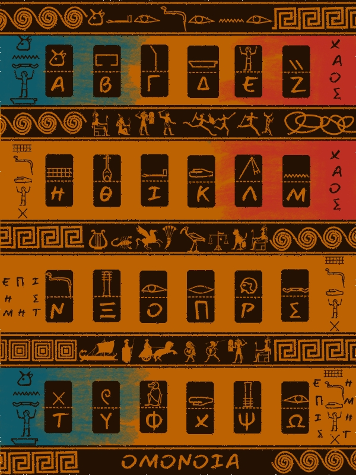
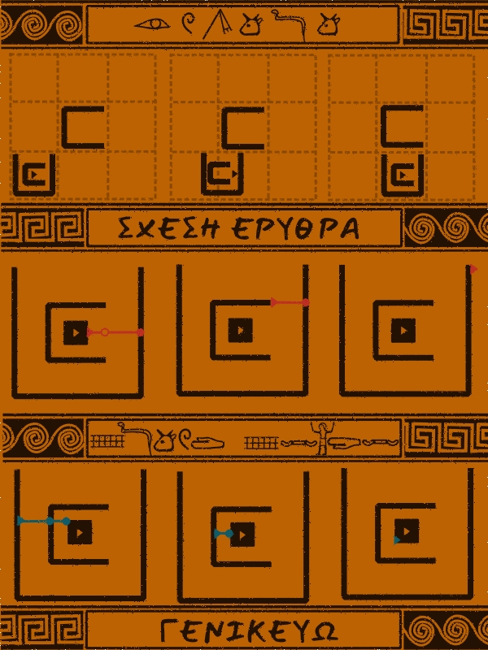
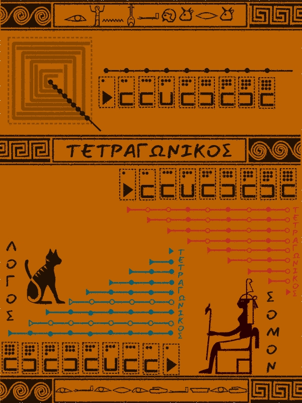
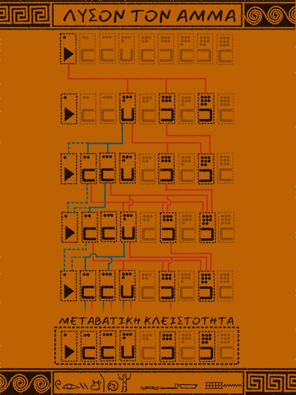
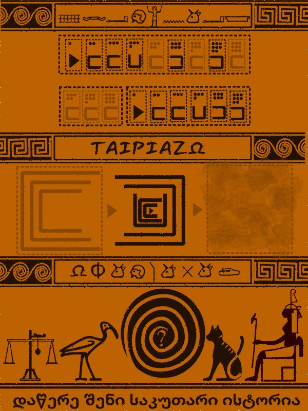

# Hypatia and the Knot of Shoes

*A round of the game in O(k) time and O(1) extra space, for any number of shoes on any square board. No code, only an argument, told as a tale.*

## The tale from the Agora

I am Hypatia. I teach numbers in the morning and stars at night. Between the two I go to the Agora, though it is not an Agora you would find on any map. No stalls, no sellers, no shouting. Only a wide square of pale stone, a low wall, and a silence that seems to be listening. I have never seen who keeps it. The stone is always swept.

That evening, on the low wall where I sit, I found a wooden box. No name, no seal, only a cord tied in a knot, badly, as if in a hurry or in fear. I looked around the empty square. Nobody waiting. Nobody watching. Even the wind held still, as though it wanted to see what I would do.

I should have asked whose it was. There was nobody to ask. So I sat down, undid the cord, and felt what I feel when a student brings me a problem I cannot solve at once: a small, shameful happiness.

Inside were five painted cards.

The first card was a key. Twenty-four small Egyptian signs, each above one Greek letter. On the side, two words pulled against each other: ΧΑΟΣ and ΕΠΙΣΤΗΜΗ, chaos and knowledge. At the bottom, ΟΜΟΝΟΙΑ, agreement. A strip of signs ran along the top. I did not try to read it yet. First I needed the key itself. The Greek was strange, not the Greek of my city, but I could read it.

The second card began with ΑΝΑΛΥΩ: analyze. A small block sat inside a shoe, and that shoe inside a bigger one. Then came two lessons.

**ΣΧΕΣΗ ΕΡΥΘΡΑ, the red relation.** When a piece moves, look ahead of it. If the next shoe is open on that side, the piece slips through. If there is a wall, the piece pushes that shoe.

**ΣΧΕΣΗ ΚΥΑΝΗ, the blue relation.** When a shoe moves, look behind it. If it has a wall at its back, it drags along everything inside it. If its back is open, the things inside are left behind.

Then **ΓΕΝΙΚΕΥΩ**: generalize. So this was about any number of shoes.

The third card said **ΑΠΑΡΙΘΜΕΩ**: count them. A block sat in the middle of eight shoes, each inside the next, like a snail shell. The card laid them out in a row and numbered them with dots, one for the block, nine for the largest shoe.

Below was the word **ΤΕΤΡΑΓΩΝΙΚΟΣ**. It means square, like the board. It also means the cost that grows like a square. Two triangles of lines showed it, one red and one blue: every piece compared with every other. For nine pieces that is thirty-six comparisons for each colour. For a hundred it is almost five thousand.

Then I looked at the little circles on the lines. In the red triangle every line had the same pattern: open, open, filled, open, filled, open, filled, open. A filled circle is a shoe with a wall to the east. The pattern never changed, whoever was pushing. In the blue triangle each line was all filled or all open. A filled line belongs to a shoe with a wall at its back, and it drags everyone inside or no one.

The strip at the bottom was worn, and I could not read it. But the lesson was clear from the diagram itself. The two great triangles hold no more knowledge than two small facts about each shoe: does it have a wall in front, and does it have a wall behind. A cat sat by one triangle, named **ΛΟΓΟΣ**, reason. A lawgiver sat by the other, named **ΝΟΜΟΣ**, law. Reason can count every pair, but the law of the shoes is shorter.

The fourth card said **ΛΥΣΟΝ ΤΟΝ ΑΜΜΑ**: loose the knot.

I looked at the diagram first. The block moves east. In the first row only the block is lit. Then shoes four, six and eight light up, by red lines. Then two and three, by blue lines. Then the rows repeat with nothing new, and the card calls the result **ΜΕΤΑΒΑΤΙΚΗ ΚΛΕΙΣΤΟΤΗΤΑ**, transitive closure. Six pieces move. Five, seven and nine stay.

Then I turned to the strip along the bottom. I read it left to right, as my own eyes go, and got **ΥΟΖΑΓΡΕ ΣΙΔ ΗΜ**. Nonsense. I began again from the right, the way the old scribes wrote, and the marks almost resolved: **ΜΗ ΔΙΣ ΕΡΓΑΖΟΥ**. Do not work twice.

The glyphs did not line up perfectly. But the sense fit. The card was scolding me for going round and round. The knot lets me work once.

And once I had the knot, the classification followed. For one direction of travel there are only three kinds of shoe.

- A shoe open toward the move. Things inside pass out through it. Nothing pushes it.
- A shoe open away from the move. It has a wall in front, so it is pushed. Its back is open, so it drags nothing.
- A shoe open to the side. It has a wall in front and a wall behind. It is pushed, and it drags everything inside it.

The card has already laid the nest out as a row. So I walk the row once, from the largest shoe to the block, with one loose end of my scarf in my hand. Before I tie a knot, shoes of the second kind travel and shoes of the first kind stay. At the first shoe of the third kind I tie the knot. After the knot, everything travels. The block always travels.

I tried it on the card. Nine is open east and stays. Eight is open west and travels. Seven stays. Six travels. Five stays. Four is open north: it travels, and I tie the knot. Three, two and the block all travel. Six travellers and three stayers, the same as the card.

Why this is right. Every piece I send truly moves: it is pushed from inside or dragged by the knotted shoe. Every piece I leave truly stays. Its front is open, so nothing pushes it, and no moving shoe outside it has a back wall, so nothing drags it. And one walk is enough. Whether a shoe is pushed depends only on its own shape, as the red triangle showed. Whether it is dragged depends only on shoes larger than itself, and I have already passed those.

The fifth card opened with **ΔΙΑΜΕΡΙΣΗ**: partition. The row was split in two, with five, seven and nine on one side and the six travellers on the other, each side still in order. I need no list for this. I keep one finger on the last traveller I passed and one on the last stayer, and each new piece is told to sit inside the shoe under its own finger. One nest becomes two.

Then **ΤΑΙΡΙΑΖΩ**: fit together. Three squares. In the first, faded, the three shoes left behind. In the middle, dark and without a frame, the travellers on their way. The third square was rubbed out. It is the cell they arrive in. The card does not say what happens when they meet the shoes already there. So this part is mine to fill.

I fill it with two rules from the old small board. The first: a shoe can only be entered through its open side, and a shoe that meets a closed side is refused. The second: the smallest piece must end up inside every shoe it meets.

From these two rules, two conditions follow.

First: every resident must be open toward the arriving travellers, because the block is the smallest piece and must end inside every shoe it meets. Second: every traveller larger than the smallest resident must be open in front, because it has to swallow that resident.

I tried the fit on the nine-piece nest. The travellers moved. The residents opened. The block found its place. I thought I had it.

Then I tried a case the card did not show. A red shoe arriving, and another red shoe of the very same size already waiting in the cell, open toward it. Both conditions held. The red slid into its own twin, and I stopped, because a shoe inside its own twin is no nest at all.

I looked at the dots again. Nine pieces, nine different numbers. No two pieces on any card wear the same number, because a nest is a chain, each shoe inside the next larger, and a chain has no room for equals. So there was a third condition after all: no two pieces of the same size may meet in one cell. I check it on the same walk, with the two fingers that will do the merge, one on each nest, comparing sizes as they go. If both fingers ever point at the same size, I refuse, and nothing has been touched.

All of this is looking, not touching. If any of the three conditions fails, I refuse and nothing has changed. Only if all three pass do I split the old nest as the card showed, merge the two nests by size, and write the result down.

Last, **ΚΑΤΑΓΡΑΦΩ**: write it down. Each piece now knows which shoe it sits in, and where it stands on the board.

The cost. I looked once at each shoe in the old cell and once at each shoe in the new one. Then my hands touched each of them once. For nine shoes that is a handful of steps each, and for nine hundred it is the same handful each. I carried one knot, one number and two fingers, whatever the number of shoes. The other cells of the board I never visited. The board's size did not enter my walk.

At the bottom of the last card stood the scales, the ibis, the cat and the lawgiver, around a spiral with a question in its heart. Under them was a line in letters I had never seen, round like vine tendrils. A trader from Colchis read it for me: **დაწერე შენი საკუთარი ისტორია**. Write your own story.

I sat with it for a while. I thought about the scales - measure. The ibis - time, for Thoth counts the days and keeps the record of them. The cat - the clever way. The lawgiver - the law. Four things you need to solve anything. Four things I had used, one at a time, without naming them.

The cards had taught me to walk a chain, to count what was already counted, to leave the third square blank until I could fill it. The cards had shown me that two triangles hold no more than two facts. They had shown me that the knot is not untied, it is seen.

And then they had handed the rest to me. Not as a test. As an invitation.

The Agora was empty by then. The stalls had folded. The wind had stopped. I gathered the cards, and I walked home, and I wrote this down.

Write your own story.

So I did.

## Appendix A: The argument in seven lines

1. **Claim:** a round (decide a move and apply it) takes O(k) time and O(1) extra space for k shoes on any N×N board.
2. **Invariant:** each square holds one nest, sorted by size, and the block is inside every shoe in its square.
3. **Who moves:** walk the block's nest from the outside in. Before the first side-open shoe, back-open shoes move and front-open shoes stay. The first side-open shoe moves and drags everything inside it. Each verdict depends only on the shoe's own shape and the shoes already passed.
4. **Where they land:** a move is legal exactly when three conditions hold: every resident is open toward the arrivals, every arriving shoe larger than the smallest resident is open in front, and no two pieces of equal size meet. All of this is looking, not touching. If legal, split the old nest into movers and stayers and merge the movers into the target nest by size. These conditions are enough, because after the merge every neighbouring pair is either a traveller entering a resident (the first condition) or a resident swallowed by a traveller (the second), and the third condition keeps the sizes strictly ordered, so the result is a valid chain.
5. **Time:** one walk over each of two nests plus one merge, with O(1) work per shoe, gives O(k).
6. **Space:** two pointers, one knot flag and one remembered size, so O(1). Each square keeps its nest sorted by size, with a link from each shoe to its next smaller neighbour. These links are the state of the game, not working memory. The board size only enters the single bounds check, and no other square is visited.
7. **Edge cases:** if the target square is empty, everything that travels simply lands there. If the target is off the board, one check on that square refuses the move. If no shoe in the block’s nest has a wall ahead, the block moves alone.

## Appendix B: The rules of my third square

The cards leave one square rubbed out, so these rules are mine. The original 3-shoe puzzle is a special case.

- **Pieces.** The block has size 1. Each shoe has a size of 2 or more and one open side. Two shoes of equal size never share a square.
- **Nests.** In any square, the pieces form one chain, each inside the next larger. The block is inside every shoe in its square.
- **A move.** The block steps one square N, E, S or W. Along that direction, each shoe in its nest is one of three kinds:
  - *Front-open* (open toward the move): things slip out through it, and it is not pushed.
  - *Back-open* (open away from the move): it has a wall ahead, so it is pushed, and it drags nothing.
  - *Side-open*: walls ahead and behind, so it is pushed, and it drags everything inside it.
  - The block always moves.
- **Arrival.** A move is legal only if all of these hold:
  - The target square is on the board.
  - Every shoe already there is open on the side the arrivals come from.
  - Every arriving shoe larger than the smallest shoe there is open in front, so it can swallow it.
  - No two shoes of equal size would meet.

  An illegal move changes nothing.
---